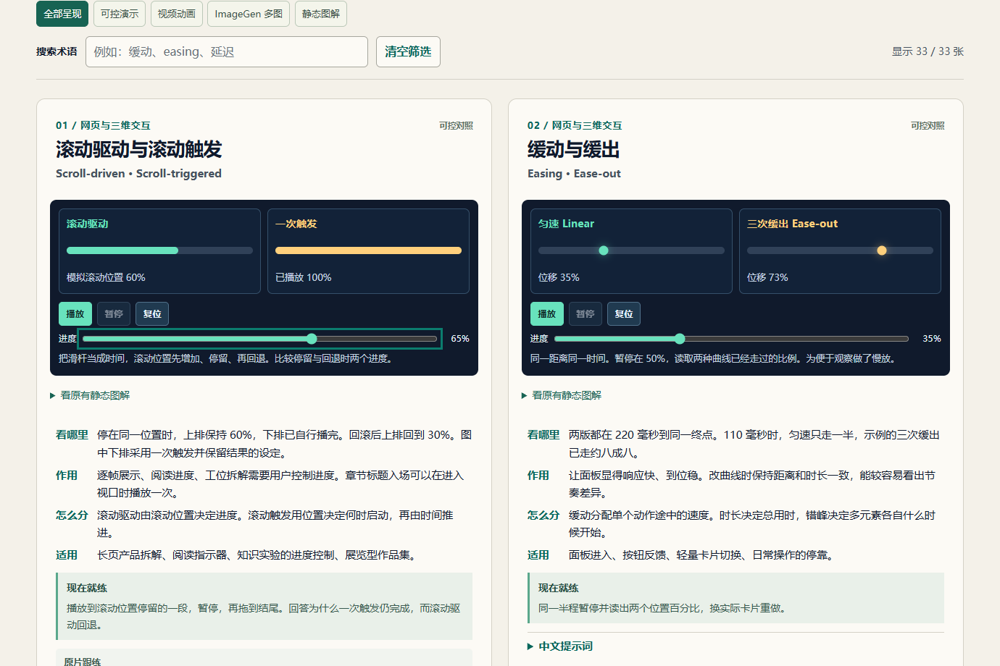

# 视觉与专业术语图鉴

用中文看懂效果、叫出中英文术语，再把画面应该怎样变化说清楚。覆盖网页动效、视频剪辑、视觉设计、工程图示、图表与验收。

[打开在线图鉴](https://yangwei251003.github.io/visual-expression-atlas/) · [原片观察与练习](https://yangwei251003.github.io/visual-expression-atlas/learning-notes.html)

## 内容

- 33 张图解卡，涵盖滚动驱动、缓动、J/L 剪接、推镜与变焦、HMI、梯形图等主题。
- 15 项可操作对照、4 支原创微片和 5 组插画对照板。
- 4 条原片的 76 条学习笔记，保留作者、原链接和时间码。另有 5 条资料的 14 段跟练。

## 本地运行

    python -m http.server 8000 --bind 127.0.0.1

打开 http://127.0.0.1:8000/，或直接打开仓库中的 index.html。搜索与交互可以离线使用，原片链接需联网。

    python -m pip install -r requirements.txt
    python build.py

study-* 和 v2-* 存放页面、卡片、交互与原创资产。notes.json 保存时间码笔记。微片的生成脚本是 v2-video/render_editing.py，重渲另外需要 NumPy 和 FFmpeg。

原创代码和文档采用 [MIT](LICENSE)。第三方作品由原链接访问，权利仍归原作者。
